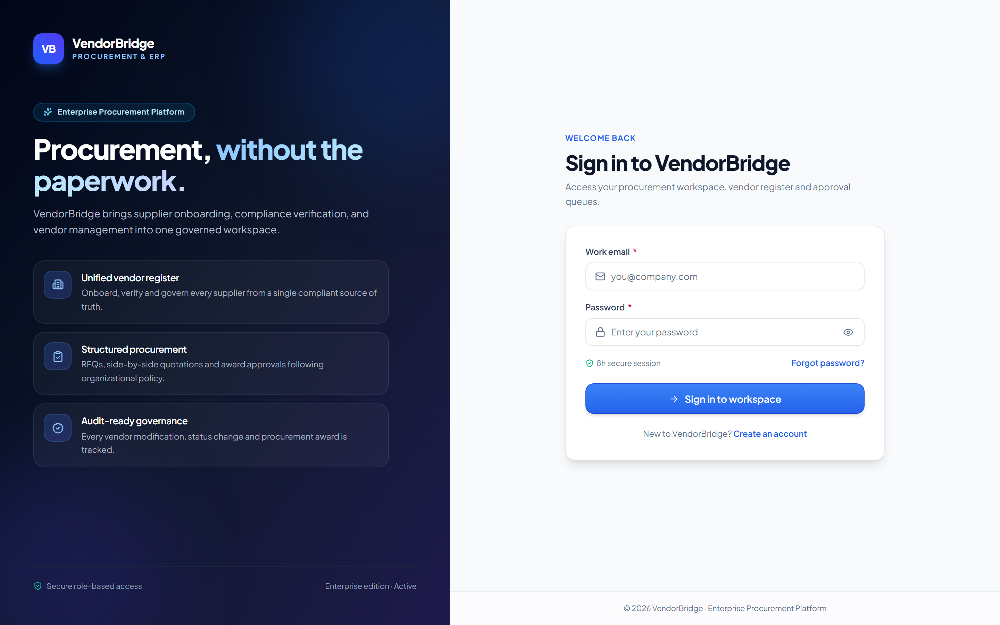
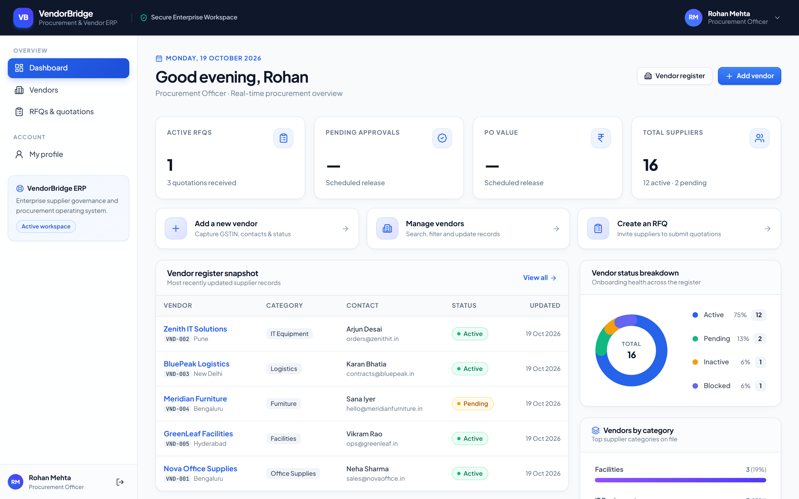
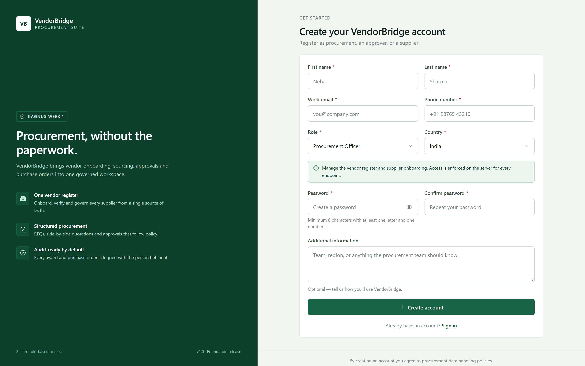
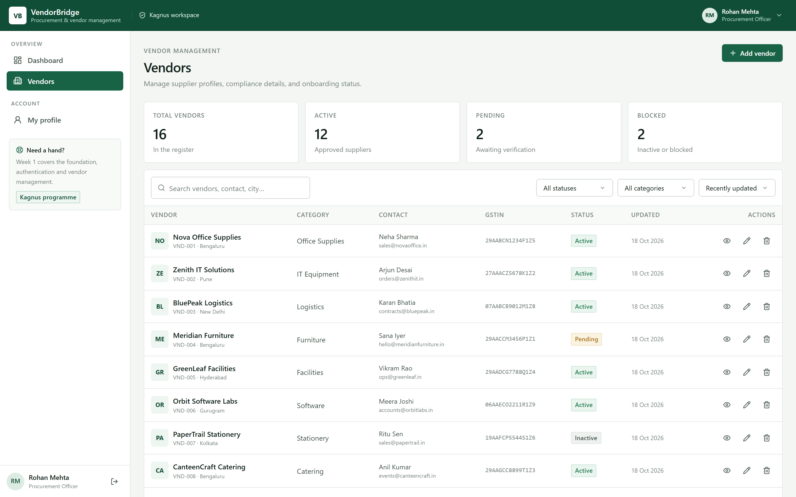

# VendorBridge — Procurement & Vendor Management ERP

Weeks 1–4 deliverable for the Kagnus programme: **Foundation & Vendor Management**,
**RFQs, Quotations & Comparison**, **Approvals, Purchase Orders & Invoices**, and
**Reports & Audit Trail**.
VendorBridge is a full-stack application — a React single-page front end talking to an
Express + PostgreSQL back end through Prisma ORM — implementing authentication, role-aware
navigation, a procurement dashboard, complete vendor management, the end-to-end
RFQ → quotation → comparison workflow, the approval → purchase order → invoice workflow with
server-rendered PDFs and transactional email, a Week 4 reporting suite with spend analytics,
CSV exports and an append-only activity trail, and a per-user notification centre driven by the
same events. Every reported figure is derived from issued purchase orders, so a report can never
disagree with the documents it summarises.

---

## 1. Tech stack

| Layer | Choice |
| --- | --- |
| Front end | React 19, TypeScript, Vite 7, Tailwind CSS 4, React Router 7 (lazy-loaded routes), TanStack Query, Framer Motion, Lucide icons |
| Back end | Node.js (ESM), Express 5, Zod validation, express-rate-limit, pdf-lib (server-rendered invoices), Resend email API |
| Cache / counters | Upstash Redis through either its REST API (`UPSTASH_REDIS_REST_URL` + token) or a `rediss://` TCP URL |
| Auth | bcrypt password hashing + signed JWT in an httpOnly cookie |
| Database | PostgreSQL (managed instance) through Prisma ORM 6, schema in `prisma/schema.prisma` |

The database connection comes from a single `DATABASE_URL` environment variable. Prisma owns
the schema, migrations and typed queries; no native database driver is compiled during install.

---

## 2. Quick start

```bash
# 1. Install dependencies (also generates the Prisma Client)
npm install

# 2. Configure environment
cp .env.example .env      # set DATABASE_URL (PostgreSQL) and JWT_SECRET

# 3. Generate Prisma Client, apply migrations, seed an empty development DB,
#    and verify connection/table counts (review DATABASE_URL first)
npm run db:setup

# 4. Run the API (port 4000) and the Vite dev server (port 5173) together
npm run dev
# open http://localhost:5173
```

Other scripts:

| Script | Purpose |
| --- | --- |
| `npm run dev` | API + Vite dev server (frontend proxies `/api` to the API) |
| `npm run dev:server` | API only, with file watching |
| `npm run build` | Type-check and build the production front end into `dist/` |
| `npm start` | Production server: serves `dist/` **and** the API on port 4000 |
| `npm run db:generate` | Regenerate the Prisma Client after editing the schema |
| `npm run db:migrate` | Create and apply a development migration (`prisma migrate dev`) |
| `npm run db:deploy` | Apply committed migrations to an existing database |
| `npm run db:status` | Check database connectivity and print row counts (no record contents) |
| `npm run db:setup` | Generate Prisma Client, apply migrations, seed an empty development DB and verify counts |
| `npm run db:studio` | Open Prisma Studio against the configured database |
| `npm run seed` | Add the demo fixture only when both users and vendors tables are empty; never overwrites existing data |
| `npm run db:seed-demo` | Idempotent Week 1–3 demo: RFQs, quotations, approvals, purchase orders and invoices through the real API |
| `npm run db:seed-week4` | Idempotent Week 4 demo: four document chains across four months, four supplier categories (app must be running) |
| `npm run test:api` | 227-check end-to-end API smoke test, Weeks 1–4 (see §7) |
| `node scripts/e2e-week2.mjs` | 76-check Week 2 browser E2E suite (app running + disposable `*e2e*` database) |
| `node scripts/e2e-week3.mjs` | 106-check Week 3 browser E2E suite (approval → PO → invoice, PDF, email) |
| `node scripts/e2e-week4.mjs` | Week 4 QA harness: 80 HTTP/browser/database checks (notifications, audit, reports, CSV, PDF/email, roles) |
| `npm run test:e2e:notifications` | 49-check notification lifecycle: every event (including rejection and cancellation), recipient, actor exclusion and per-user scope (app running) |
| `npm run db:cleanup-tests` | Remove only `@vendorbridge.test` accounts/vendors, `[smoke]` RFQs and their notifications created by the test suites |
| `npm run screenshots` | Regenerate the screenshots in `docs/screenshots/` (needs the app running) |
| `npm run typecheck` | TypeScript check |

Demo data is loaded only by the explicit development `npm run seed` command (also included in
`npm run db:setup`) and only when both the `users` and `vendors` tables are empty. The server does
not seed data on startup, and demo seeding is disabled in production. Do not use demo credentials
or fixtures in a production database.

---

## 3. Demo accounts

In a disposable development database, the server-only seed script creates one account per role
for smoke testing. Credentials are not bundled into the browser login page. Seed accounts are
fixtures only; never use them in production.

### Live review deployment

The submission build is deployed at <https://vendor-bridge-kagnus.vercel.app> from `main`;
the notification delivery was merged in `354f1ba`. It uses the seeded demo fixtures below so every
role can be exercised:

| Role | Email | Password |
| --- | --- | --- |
| Admin | `admin@vendorbridge.dev` | `Admin@123` |
| Procurement Officer | `procurement@vendorbridge.dev` | `Procure@123` |
| Manager / Approver | `manager@vendorbridge.dev` | `Manager@123` |
| Vendor | `vendor@vendorbridge.dev` | `Vendor@123` |

These are demo identities, not real credentials. Remove or rotate them before using the database
for anything other than review.

---

## 4. Features delivered

### 4.1 Authentication (requirement 1)

- Public registration validates names, email, phone, country and password, and always creates a
  **Vendor** account with a linked **Pending** vendor profile. Public clients cannot choose an
  internal or elevated role.
- Admin, Procurement and Manager records exist only in the server-side development seed fixture; do
  not load these demo accounts into production.
- Email + password login, logout, and session restore via a signed JWT in an httpOnly cookie
  (8 hour expiry, `sameSite=lax`, `secure` in production).
- Forgot-password → single-use, 30-minute reset token → password reset. Reset emails use Resend
  when `RESEND_API_KEY` is configured; local development falls back to a mail outbox and a
  development-only direct-link helper. Configure `CLIENT_ORIGIN` to your public HTTPS app URL
  in production. Reset tokens are never exposed by production endpoints.
- Login throttling: 10 attempts per IP + email within 15 minutes returns `429`. Counters are
  stored in Redis (when `REDIS_URL` is set) or PostgreSQL via `express-rate-limit`, so they
  survive restarts and work across multiple Node.js instances.
- Read caching: with `REDIS_URL` set, the dashboard summary (20 s) and the vendor category index
  (60 s) are served through Redis (`server/cache.js`). Writes advance a per-namespace version, so
  the next read after a change recomputes. Without Redis — or if it is unreachable — every read
  goes straight to PostgreSQL; the cache never fails a request.
- Four roles: **Admin, Procurement Officer, Manager/Approver, Vendor**.
- Every API route is guarded server-side (`requireAuth` / `requireRole`). Role restrictions are
  enforced on the backend, not just hidden in the UI.
- React route guards redirect unauthenticated users to `/login` and keep signed-in users out of
  login/registration, while recovery pages remain available from Profile and emailed reset links.

### 4.2 Dashboard (requirement 2)

- Role-aware greeting, role label and the four summary cards from the design reference.
- **Total suppliers**, status totals, recent vendors and category breakdown are fetched from
  `/api/dashboard` and computed from PostgreSQL. Vendors see only their own profile metrics.
- All four cards are live: **Active RFQs**, **Pending approvals**, **PO value** (grouped by
  currency) and **Total suppliers**, each computed server-side from PostgreSQL.
- Quick actions: add a vendor, open the vendor register, and create an RFQ (enabled in Week 2;
  staff get the create form, vendors get their invitation list).
- Vendor register snapshot (five most recently updated vendors) with status chips.
- Vendor status donut and vendor-by-category breakdown, both computed from stored records.
- A "Now live in Week 4" card links to Reports and the Activity log for staff roles.
- Skeleton loaders, empty states and an error state with retry; vendors see their own profile
  instead of the internal register.

### 4.3 Vendor management (requirement 3)

- Create, list, view, update and delete vendors — restricted to Admin and Procurement Officer.
- Fields: name, category, GSTIN, contact person, email, phone, address, city, country,
  status (Active / Pending / Inactive / Blocked), rating (0–5) and internal notes.
- Server-side search (name, code, email, contact, city), status and category filters, five sort
  orders and pagination.
- Vendor detail drawer with contact, billing details, compliance, rating and record metadata.
- Unique vendor code per record (`VND-001`…), duplicate-name protection (`409`) and full
  Zod validation (`422` with per-field messages).
- Vendors can only read their own record; cross-vendor reads and global vendor metadata return `403`.
- Internal procurement notes are redacted from vendor-facing API responses.
- Records are stored in PostgreSQL and survive refreshes, restarts and new sessions.

### 4.4 Technical requirements (requirement 4)

- Approved stack, single repository, `src/` (front end) and `server/` (API + database) separated.
- Configuration through environment variables (`PORT`, `JWT_SECRET`, `JWT_EXPIRES_IN`,
  `DATABASE_URL`, `CLIENT_ORIGIN`, `NODE_ENV`); no secrets in front-end code.
- Optional Redis (rate-limit counters and the dashboard/vendor cache):
  `UPSTASH_REDIS_REST_URL` + `UPSTASH_REDIS_REST_TOKEN`, or `REDIS_URL=rediss://…` for the
  TCP endpoint. Both work in production; with neither set — or while Redis is unreachable —
  counters use PostgreSQL and reads go straight to the database (see section 4.7).
- Transactional email for invoice delivery and password resets: `RESEND_API_KEY` and
  `EMAIL_FROM`. `EMAIL_DEV_OUTBOX=true` writes messages to a local outbox in development.
- Reusable UI components (buttons, fields, cards, modal, table, badges, skeleton, empty and
  error states) and consistent API error handling on both sides.
- Security headers, a CORS allow-list, `x-powered-by` disabled, parameterised Prisma queries and
  foreign keys enforced at the database level.

### 4.5 RFQs, quotations & comparison (Week 2 requirements)

- **Create & publish RFQs** (Admin/Procurement): title, requirements, ordered line items with
  description, quantity, unit and specifications, a single clearly selected currency, a future
  submission deadline and vendor assignments. Client validation mirrors the server's Zod rules, so
  invalid or missing fields produce field-level errors and never create a partial RFQ.
- **Lifecycle**: `draft → open → closed` (+ `draft|open → cancelled`), `409` on invalid transitions,
  publishing locks line items and assignments, unique `RFQ-####` references generated atomically,
  and an open RFQ past its deadline reports an `expired` effective status that refuses submissions.
- **Vendor visibility**: only assigned vendors can read a published RFQ; unassigned RFQs return
  `404` (references are never disclosed), and quotation lists/comparison are `403` for vendors.
- **Quotations**: an assigned vendor submits per-line unit prices, delivery timeline, delivery
  terms, notes, tax and shipping — one quotation per RFQ, resubmittable as a new revision before
  the deadline. All money (line totals, subtotal, tax, total) is calculated on the server; the
  client cannot set vendor id, currency, totals, owner or timestamps.
- **Quotation register & side-by-side comparison**: per-line vendor prices, delivery timelines and
  notes shown to authorized staff, server-recomputed totals on a stated basis (same currency, tax
  and shipping included), the lowest valid comparable quotation highlighted exactly once, and
  incomparable quotations excluded with explicit reasons. Comparison never awards anything.
- **Sorting, filters and empty states**: search, lifecycle tabs with counts, sorting and pagination
  on the RFQ list; explicit zero-quotation, single-quotation and no-comparison states instead of
  fabricated values.
- **Persistence**: every view reads PostgreSQL — RFQs, assignments, quotations and comparison
  results survive reloads, re-login and server restarts; nothing in the front end is hard-coded.

### 4.6 Approvals, purchase orders & invoices (Week 3 requirements)

- **Approval management** (Admin/Procurement request, Manager/Admin decide): a reviewer sees the
  pending queue with status counts derived from the database; each decision stores the reviewer,
  the timestamp and free-text remarks, and appends to an immutable event timeline
  (requested → approved/rejected) that the UI renders in order.
- **Exactly one decision** is possible: `POST /api/approvals/:id/approve|reject` locks the approval
  row, re-reads it and updates `WHERE status = 'pending'`, so a second click — or a second manager —
  gets a `409` instead of overwriting the first decision. Self-approval is rejected with `403`, and
  only Admin/Manager can decide at all (procurement and vendors are refused server-side).
- **A quotation can be reviewed once**, and an RFQ can only ever have one pending or approved
  request. Rejected requests stay on record and remain searchable by status.
- **Reviewed terms cannot drift**: requesting approval stores a versioned snapshot of the
  quotation (revision, totals, line items). Approval, PO and invoice generation all re-validate the
  live rows against that snapshot and the server-side money calculation, and refuse to continue if
  anything changed (`409 quotation_changed`).
- **Purchase orders** are generated from an approved request only — a pending or rejected request
  returns `409 approval_required`. The document carries a unique sequential number (`PO-0001`),
  the vendor from the quotation, the reviewed line items (description, quantity, unit, unit price,
  line total), the currency and the tax/shipping/total figures, and is linked to its source
  quotation, RFQ and approval (`purchase_order.quotation_id`, `rfq_id`, `approval_request_id` are
  unique/foreign keyed).
- **Duplicate generation is prevented twice over**: a unique index on `approval_request_id` plus a
  row lock inside the transaction. A second click returns the existing document with `created:
  false` instead of creating another.
- **Invoices** are generated from an issued purchase order only (a cancelled PO returns `409`), copy
  the approved subtotal, tax, delivery charge and total without recomputing them, carry a unique
  `INV-0001` number, an issue date and a client-supplied due date (validated to at most one year
  after issue; the UI defaults to 30 days), and are linked to the purchase order, RFQ and vendor.
  One invoice per purchase order is enforced by a unique index and the same lock-then-return
  strategy.
- **PDF and print**: `GET /api/invoices/:id/pdf` renders the invoice server-side with pdf-lib
  (vendor, PO/RFQ references, line items, totals, payment terms) and streams it as
  `application/pdf` with a `Content-Disposition` filename. Invoices have a dedicated print route
  that renders the same document without the app shell, so `window.print()` produces the identical
  layout. Purchase orders are readable in the app but do not (yet) have their own PDF endpoint.
- **Email delivery with real feedback**: `POST /api/invoices/:id/send` renders the PDF, sends it to
  the vendor address on file through Resend, and records `sent` / `failed` / `not_configured` with
  the provider, attempt count, timestamp and a redacted error message — each transition also
  appends an invoice event, so the UI can show the last attempt and its error.
- **Vendor scope**: vendors can read only their own purchase orders and invoices (another vendor's
  document is reported as `404`, never `403`, so ids cannot be probed) and can never generate or
  send documents. Every list is `Cache-Control: no-store`.

### 4.7 Reports & audit trail (Week 4 requirements)

- **Spend analytics** (`GET /api/reports/overview`): period presets (30/90/180/365 days) over
  issued purchase orders — awarded spend, order count, invoiced value, overdue invoices, approval
  turnaround, request → PO cycle time, RFQ/quotation throughput, supplier counts, a monthly trend,
  a category split and the top suppliers by awarded value.
- **Currency correctness**: purchase orders can be priced in different currencies, so spend is
  never summed across them. The report selects the dominant currency for the period, returns every
  currency bucket, and the UI states how many orders were excluded from the breakdowns.
- **Supplier performance** (`GET /api/reports/vendors`): invitations, quotations received, awards,
  win rate and average quoted lead time per supplier for the selected period.
- **CSV exports** (`GET /api/reports/export?type=spend|purchase-orders|invoices`): attachment
  download with a `Content-Disposition` filename, UTF-8 BOM for Excel, CRLF rows, quoted fields and
  a formula-injection guard for cells beginning with `=`, `+`, `-` or `@`.
- **Staff-only**: vendors receive `403` on every report endpoint, including exports; the checks are
  server-side, not just hidden navigation.
- **Audit trail** (`GET /api/activity`): every state-changing action writes one row — sign-in
  success/failure, password reset, vendor create/update/delete, RFQ create/update/assign/publish/
  close/cancel, quotation submit/revise, approval request/decision, purchase order generate/cancel,
  invoice generate and email delivery. Each row stores an actor snapshot, role, action, entity
  type/id, a human summary, JSON metadata, IP address and user agent.
- **Append-only at the database level**: `audit_logs` carries triggers that reject every UPDATE and
  DELETE, so history cannot be rewritten through the API, Prisma or raw SQL. The actor snapshot
  keeps entries readable after an account is removed, and `actor_id` is deliberately a historical
  reference without a foreign key (an `ON DELETE SET NULL` would itself mutate an append-only row).
- **Query and drill-down**: full-text search plus action, record type, actor and date-range filters,
  facet counts, pagination, and a detail endpoint that returns the entry together with the same
  record's other events.
- **UI**: a Reports page (KPI cards, monthly bars, category donut, top suppliers, supplier
  performance table, CSV buttons) and an Activity page (filters, colour-coded action chips, record
  references and a metadata drawer), both limited to Admin, Procurement and Manager.
- **Report semantics**: spend follows issued purchase orders (cancelled ones are excluded),
  invoices are counted by issue date, and "overdue" means an issued invoice whose due date has
  passed. Totals come from stored `DECIMAL` values; the browser only formats them.

### 4.8 Per-user notifications

- **Persistent model** (`notifications`): one row per recipient with `type`, human `title` and
  `body`, optional `entity_type`/`entity_id`, a deep `link`, optional vendor reference and
  `read_at`. Deleting a user cascades their rows; deleting a vendor nulls the historical vendor
  reference instead of destroying the notification. Indexes cover the unread badge and the
  reverse-chronological inbox.
- **Written from the event, not the UI**: `server/notify.js` is called by the same route that
  performs the action, after the transaction commits, so a notification always corresponds to a
  saved document. A failed insert is logged and never rolls back the business action.
- **Events covered**: RFQ published/closed/cancelled to assigned vendors; quotation
  submitted/revised to the RFQ creator; approval requested to Admin/Manager reviewers; approval
  approved/rejected to the requester and the winning vendor; purchase order issued to the vendor;
  invoice generated to the vendor; invoice email sent/not-configured/failed to the procurement
  team and requester. The actor is excluded, duplicates are collapsed, and vendors with no linked
  account are skipped (they have no bell to notify).
- **API**: `GET /api/notifications` (newest first, `filter=all|unread`, pagination and an unread
  total), `GET /api/notifications/unread-count`, `POST /api/notifications/:id/read` and
  `POST /api/notifications/read-all`. Every query is scoped to `req.user.id`; there is no endpoint
  that accepts a user id, and another user's notification is reported as `404` so ids cannot be
  probed. Vendors and staff use the same routes and see only their own rows.
- **UI**: a bell in the top bar polls the unread count every 30 seconds, shows a badge, opens a
  panel with All/Unread filters, marks a notification read when it is opened, deep-links to the
  related document, and offers "Mark all read". The panel uses the same accessible dialog/escape/
  outside-click behaviour as the profile menu.

### 4.9 Redis in production

- `server/redis.js` is the single connection used by the cache (`server/cache.js`) and the rate
  limiter (`server/rateLimit.js`). It accepts an Upstash **REST** URL plus token (recommended on
  Vercel — one HTTPS request per command, nothing to leak between serverless invocations) or a
  **TCP** `rediss://` URL through ioredis. `UPSTASH_REDIS_REST_*` and `KV_REST_API_*` names are
  both recognised, and a REST URL pasted into `REDIS_URL` is understood rather than ignored.
- Everything fails open: if Redis is slow, misconfigured or down, sign-in falls back to the
  PostgreSQL counter store (still enforcing the limit) and reads go to the database. A short
  cooldown stops a dead endpoint from costing a timeout on every request. Redis is never a hard
  dependency, so a cache outage cannot turn the login page into a `500`.

---

## 5. Architecture

```
src/                 React SPA
  components/        AppLayout, guards, UI kit, vendor form, RFQ form, invoice sheet, charts
  context/           Auth and toast providers
  lib/               API client, types, formatting, RFQ helpers, hooks
  pages/             auth/, Dashboard, Vendors, Profile, RfqList/Create/Detail/Quotation(s)/Comparison,
                     Approvals, PurchaseOrders, PurchaseOrderDetail, Invoices, InvoiceDetail, InvoicePrint,
                     Reports, Activity, NotFound
prisma/
  schema.prisma      PostgreSQL models, relations and indexes
  migrations/        committed SQL migrations (init, rate limits, RFQ quotations, Week 3 documents,
                     append-only quotation revisions, Week 4 audit log, notifications, cascade reconciliation)
server/
  auth.js            password hashing, JWT, guards, validation error mapping
  db.js              shared Prisma Client, sequences and user mapping
  audit.js           Week 4 action catalogue and append-only audit writer
  seed.js            demo users and vendors
  serializers.js     response shapes and role permissions
  money.js           server-side rounding and quotation money totals
  workflow.js        approval snapshots, document consistency checks, row locks, numbering
  services/reports.js  spend/supplier read models, period validation and CSV export
  pdf.js             pdf-lib invoice documents
  email.js           Resend delivery plus the development outbox
  cache.js           versioned read cache in front of expensive read models
  redis.js           single Upstash REST/TCP connection, fail-open with cooldown
  rateLimit.js       Redis-first, database-backed rate limiter
  notify.js          event-driven notification writers, recipient rules and serializer
  routes/            auth.js, vendors.js, rfqs.js, dashboard.js, approvals.js, purchaseOrders.js,
                     invoices.js, reports.js, activity.js, notifications.js
  index.js           Express app, security headers, SPA fallback
scripts/
  smoke-test.mjs     end-to-end API test suite (Weeks 1–4, 227 checks)
  e2e-week2.mjs      Week 2 browser E2E suite (76 checks)
  e2e-week3.mjs      Week 3 browser E2E suite (106 checks: approval → PO → invoice, PDF, email)
  e2e-week4-notifications.mjs  49-check notification events, recipients and scope (cleans its chains)
  seed-week12-demo.mjs  idempotent demo data: RFQs, quotations, approvals, PO, invoice
  seed-week4-demo.mjs   four backdated procurement chains for the Week 4 reports and audit trail
  screenshots.mjs    screenshot capture for the submission pack
```

### API endpoints

| Method | Path | Access |
| --- | --- | --- |
| `POST` | `/api/auth/register` | Public |
| `POST` | `/api/auth/login` | Public |
| `POST` | `/api/auth/logout` | Public (clears session) |
| `GET` | `/api/auth/me` | Signed in |
| `POST` | `/api/auth/forgot-password` | Public |
| `POST` | `/api/auth/reset-password` | Public (needs a valid token) |
| `GET` | `/api/auth/dev-reset-link` | Development only (disabled in production) |
| `GET` | `/api/dashboard` | Admin/Procurement/Manager: aggregate metrics; Vendor: own profile metrics only |
| `GET` | `/api/rfqs` | Signed in (vendors: only published RFQs assigned to them; search, status, sort, pagination) |
| `POST` | `/api/rfqs` | Admin, Procurement |
| `GET` | `/api/rfqs/:id` | Signed in (vendor: assigned + published only, otherwise `404`) |
| `PUT` | `/api/rfqs/:id` | Admin, Procurement (draft only; `409` after publish) |
| `PUT` | `/api/rfqs/:id/vendors` | Admin, Procurement (draft only) |
| `POST` | `/api/rfqs/:id/publish` | Admin, Procurement |
| `POST` | `/api/rfqs/:id/close` | Admin, Procurement |
| `POST` | `/api/rfqs/:id/cancel` | Admin, Procurement |
| `GET` | `/api/rfqs/:id/quotations` | Admin, Procurement, Manager (vendors `403`) |
| `GET` | `/api/rfqs/:id/comparison` | Admin, Procurement, Manager (vendors `403`) |
| `PUT` | `/api/rfqs/:id/quotation` | Vendor assigned to the RFQ (create or revise; identity from session, never from payload) |
| `GET` | `/api/approvals`, `/api/approvals/queue`, `/api/approvals/:id` | Admin, Procurement, Manager |
| `POST` | `/api/approvals` | Admin, Procurement (one request per quotation, one active per RFQ) |
| `POST` | `/api/approvals/:id/approve`, `/api/approvals/:id/reject` | Admin, Manager (never the requester) |
| `GET` | `/api/purchase-orders`, `/api/purchase-orders/:id` | Staff: all; Vendor: own documents only |
| `POST` | `/api/purchase-orders` | Admin, Procurement (approved request only; duplicate returns the existing PO) |
| `POST` | `/api/purchase-orders/:id/cancel` | Admin, Procurement (no invoice yet) |
| `GET` | `/api/invoices`, `/api/invoices/:id`, `/api/invoices/:id/pdf` | Staff: all; Vendor: own documents only |
| `GET` | `/api/reports/overview` | Admin, Procurement, Manager (spend KPIs, trend, categories, top suppliers) |
| `GET` | `/api/reports/vendors` | Admin, Procurement, Manager (supplier performance) |
| `GET` | `/api/reports/export` | Admin, Procurement, Manager (`type=spend|purchase-orders|invoices`, CSV) |
| `GET` | `/api/activity`, `/api/activity/:id` | Admin, Procurement, Manager (audit trail; vendors `403`) |
| `GET` | `/api/notifications`, `/api/notifications/unread-count` | Signed in — always scoped to the session's own rows |
| `POST` | `/api/notifications/:id/read`, `/api/notifications/read-all` | Signed in — another user's row returns `404` |
| `POST` | `/api/invoices` | Admin, Procurement (issued PO only; duplicate returns the existing invoice) |
| `POST` | `/api/invoices/:id/send` | Admin, Procurement (records sent/failed/not_configured) |
| `GET` | `/api/vendors` | Signed in (vendors see only themselves) |
| `GET` | `/api/vendors/meta` | Admin, Procurement, Manager (vendors are denied global metadata) |
| `GET` | `/api/vendors/:id` | Signed in (vendors only their own) |
| `POST` | `/api/vendors` | Admin, Procurement |
| `PUT` | `/api/vendors/:id` | Admin, Procurement |
| `DELETE` | `/api/vendors/:id` | Admin, Procurement |
| `GET` | `/api/health` | Public (API and required database tables readiness; no row counts) |

### Role permission matrix

| Capability | Admin | Procurement | Manager | Vendor |
| --- | --- | --- | --- | --- |
| View dashboard | ✅ | ✅ | ✅ | ✅ (own profile) |
| View vendor register | ✅ | ✅ | ✅ | own record only |
| Create / update / delete vendors | ✅ | ✅ | ❌ | ❌ |
| Create / edit / publish / close / cancel RFQs | ✅ | ✅ | ❌ | ❌ |
| View RFQs | all | all | all | assigned + published only |
| Submit / revise quotations | ❌ | ❌ | ❌ | ✅ (own, assigned) |
| View all quotations & comparison | ✅ | ✅ | ✅ (read-only) | ❌ |
| Request approval for a quotation | ✅ | ✅ | ❌ | ❌ |
| Approve / reject a request | ✅ | ❌ | ✅ (never own request) | ❌ |
| Generate / cancel purchase orders | ✅ | ✅ | ❌ | ❌ |
| Generate invoices, download PDFs, send email | ✅ | ✅ | ❌ | ❌ (own PDF read only) |
| View purchase orders & invoices | all | all | all | own documents only |
| View reports and export CSV | ✅ | ✅ | ✅ | ❌ |
| Read the audit trail | ✅ | ✅ | ✅ | ❌ |

---

## 6. Database

PostgreSQL managed through Prisma ORM. The connection string is read from `DATABASE_URL`; database
connection credentials are not hard-coded and `.env` is gitignored. Server-side seed accounts are
development-only fixtures and must never be loaded into production.

### Models

| Model | Table | Purpose |
| --- | --- | --- |
| `User` | `users` | Accounts, role, bcrypt password hash |
| `PasswordReset` | `password_resets` | Single-use reset tokens with expiry |
| `Vendor` | `vendors` | Vendor master data, status, rating, optional account link |
| `Rfq` | `rfqs` | Reference, title, currency, status, deadline, creator, lifecycle timestamps |
| `RfqItem` | `rfq_items` | Ordered requested lines: description, quantity, unit, specifications |
| `RfqAssignment` | `rfq_assignments` | RFQ ↔ vendor join, `UNIQUE(rfq_id, vendor_id)` |
| `Quotation` | `quotations` | One live bid per vendor per RFQ: delivery, notes, tax/shipping/total, `revision`, `superseded_at` |
| `QuotationItem` | `quotation_items` | Unit price + server-calculated line total per RFQ line (never deleted) |
| `Counter` | `counters` | Atomic sequence for vendor codes (`VND`), RFQ references (`RFQ`), `PO` and `INV` numbers |
| `RateLimit` | `rate_limits` | Persistent rate-limit counters used when Redis is absent or unavailable |
| `ApprovalRequest` | `approval_requests` | Quote under review: requester, approver, status, remarks, timestamps, JSON snapshot |
| `ApprovalEvent` | `approval_events` | Append-only timeline (requested / approved / rejected) with actor and remarks |
| `PurchaseOrder` | `purchase_orders` | Unique `PO-####`, links to RFQ + quotation + approval, totals, status, cancellation |
| `PurchaseOrderItem` | `purchase_order_items` | Snapshot of the approved line items (description, quantity, unit, price, line total) |
| `Invoice` | `invoices` | Unique `INV-####`, one per purchase order, issue/due dates, email delivery state |
| `InvoiceItem` | `invoice_items` | Invoice line items copied from the purchase order |
| `InvoiceEvent` | `invoice_events` | Timeline for generation and each email attempt |
| `AuditLog` | `audit_logs` | Append-only activity trail: actor snapshot, action, record, summary, metadata, IP, user agent |

`Vendor` has two relations to `User`: the vendor's own account (`user_id`) and the staff member
who created the record (`created_by`), both `ON DELETE SET NULL`.

### Migrations

```bash
npx prisma migrate dev --name <change>   # author a migration locally
npm run db:deploy                        # apply committed migrations in any environment
npm run db:studio                        # browse data
```

Migrations live in `prisma/migrations/` and are part of the repository. The initial migration
(`init`) creates the core tables, indexes and foreign keys; `add_rate_limits` and
`20261019140000_add_rfq_quotations` follow, then the Week 3 migrations add the approval, purchase
order and invoice tables with their CHECK constraints, and
`20261020150000_append_only_quotation_revisions` adds `superseded_at`, the partial unique index for
live bids, a `BEFORE INSERT` trigger that rejects late quotations at the database clock, and
delete guards that make vendor pricing physically append-only. Week 4 adds
`20261021120000_add_audit_log` (the trail plus `UPDATE`/`DELETE` guard triggers), removes the audit
actor foreign key so append-only rows cannot block account deletion, and reconciles the quotation
foreign keys with the schema (`ON DELETE CASCADE`) so deleting an RFQ or vendor can still remove
its bids. `npm run seed` inserts the demo fixture
only into a development database with no users or vendors. It never overwrites existing records.
A destructive reseed is blocked unless `ALLOW_DESTRUCTIVE_SEED=true` is explicitly set, and is
never permitted when `NODE_ENV=production`.

### When a deploy fails on a migration

`vercel.json` runs `node scripts/migrate-deploy.mjs`, which wraps `prisma migrate deploy`, retries
once on a transient connection error and names the blocking migration when it gives up. Two codes
stop a build, and both are fixed **once, against that database**, not in the code:

| Code | Meaning | Fix |
| --- | --- | --- |
| `P3018` | The migration's SQL failed — most often `column "…" already exists` because the schema was changed outside Prisma (`db push`, a manual SQL run) | `npx prisma migrate resolve --rolled-back "<migration_name>"`, then redeploy |
| `P3009` | An earlier migration is still recorded as failed, so Prisma refuses to apply anything else | resolve that migration first; its name is in the error and the wrapper prints the command |

Use `--rolled-back` when the migration did not (fully) apply and must run again, and `--applied`
when the database already contains those objects. Both only edit Prisma's `_prisma_migrations`
bookkeeping rows — no table data is touched. Confirm with `npx prisma migrate status` (it must say
*Database schema is up to date*), then redeploy.

Do not restore a deleted migration folder through a merge: Prisma applies every folder in
`prisma/migrations/`, and a resurrected migration is either applied twice or fails against a
database that already has its objects. `scripts/migrate-deploy.mjs` prints a warning when two
folders share a timestamp, which is how such a resurrection shows up.

---

## 7. Testing

```bash
npm run db:deploy    # ensure the PostgreSQL schema exists
npm run dev:server   # in one terminal
npm run test:api     # in another
```

The suite runs against the real PostgreSQL database configured in `DATABASE_URL`.

`scripts/smoke-test.mjs` performs **227 assertions** against the running API when executed, covering:

1. Authentication — health readiness, 401s for anonymous access, wrong-password rejection,
   HttpOnly cookie session refresh, all four roles signing in, no JWT/password hashes in JSON responses,
   logout clearing the session, `Cache-Control: no-store` on authenticated responses, and the local
   reset-token helper being unreachable unless explicitly enabled.
2. Backend authorization — vendor and manager blocked (403) from vendor writes, manager read
   access, vendor-scoped reads, cross-vendor access denied, and global vendor metadata restricted.
3. Vendor management — 422 validation with field errors, create with `VND-###` code, duplicate
   name conflict (409), update, search, status and category filters, sorting, pagination,
   invalid filter rejection (400), meta endpoint.
4. Dashboard — internal and vendor scopes, status/category counts reconciling with supplier
   totals, recent-vendor limit, and vendor isolation from global counts and internal notes.
5. Registration and password reset — weak password rejection, public sign-up forced to the Vendor
   role even when a privileged role is submitted, vendor sign-up creating a Pending profile,
   duplicate email conflict, reset token issuance, single-use tokens, password change and sign-in
   with the new password.
6. Week 4 reports — anonymous access is refused (401), vendors are refused (403) on reports,
   exports and the audit trail, staff can read the overview/performance/CSV endpoints, currency
   buckets and monthly spend reconcile with the reported totals, category shares sum to 100%,
   inverted/malformed/over-long ranges and unknown export types are rejected (422), CSV responses
   carry the right content type, attachment filename, BOM-free-to-fetch header row and `no-store`.
7. Week 4 audit trail — staff can read the filtered, paginated feed and its facets, an entry can
   be opened with its related record history, creating/updating/deleting a vendor is recorded with
   the actor's name, and a direct `UPDATE` or `DELETE` on `audit_logs` is refused by the database
   triggers (verified inside the suite).
8. Persistence — created vendors survive into a new session, and deletion is permanent.

Note: the smoke test registers throwaway accounts under the reserved `@vendorbridge.test` domain.
Run `npm run db:cleanup-tests` afterwards to delete only those records; seeded demo data and real
vendor records are never touched. Only if the configured database is disposable development data,
explicitly set `ALLOW_DESTRUCTIVE_SEED=true` before using `npm run seed -- --force` to reset it.
That command truncates application tables and should not be used on shared data.

Week 4 coverage also includes the role boundaries (vendor report/audit `403`s), the append-only
guarantee, the audit actor snapshot and the report/CSV shape. Week 2 coverage inside the same suite:
RFQ creation and Zod validation (422 field errors),
client-supplied `status`/`reference`/`createdBy` ignored, lifecycle `409`s (duplicate publish,
edit/assign after publish, double close), publish rules (≥1 line, ≥1 vendor, future deadline),
unique references under concurrent creation, vendor scoping (unassigned `404`, unassigned submit
`403`, quotation/comparison `403` for vendors), server-computed money and tamper resistance,
single-submission/revision policy, deadline-expired `409`, comparison sorting and lowest-price
highlight with exclusion reasons, currency-mismatch exclusion, filters, pagination metadata,
`Cache-Control: no-store`, and persistence across a fresh session.

`scripts/e2e-week2.mjs` is a separate **76-check browser suite** driven through a real browser
against the running app: the procurement → two vendors → comparison workflow, negative
authorization cases with status codes, empty/boundary states, append-only revisions, and read-only
database verification. It refuses to run unless `DATABASE_URL` points at a loopback database whose
name contains `e2e`, and it deletes only the RFQs/quotations it created. Full report:
[`docs/WEEK2_E2E_VERIFICATION.md`](docs/WEEK2_E2E_VERIFICATION.md) with machine-readable results in
`docs/verification/week2/results.json`.

`scripts/e2e-week4.mjs` is the independent **Week 4 QA harness**: it drives the real HTTP API and a browser against a disposable loopback database, recomputes every reported figure from PostgreSQL, downloads the PDF and CSV files, inspects the mail outbox, and proves audit immutability by attempting a raw `UPDATE`/`DELETE`. Its notification section runs `scripts/e2e-week4-notifications.mjs`, which creates real RFQ → quotation → approval → PO → invoice chains plus a rejected approval and a cancelled RFQ, asserts every recipient and scope rule (including actor exclusion), and removes what it created. The notification harness records **49 passed, 0 failed**; its full output is saved as [`docs/verification/week4/notifications.txt`](docs/verification/week4/notifications.txt). The full archive in [`docs/verification/week4-e2e-results.json`](docs/verification/week4-e2e-results.json) was regenerated on a fresh disposable UTF-8 database and records **78 passed, 0 failed and 2 not implemented of 80 checks**. Both harnesses refuse to run unless the target is loopback with `e2e` in its name; `NOTIFY_E2E_ALLOW_REMOTE=1` exists only for an explicitly disposable remote database.

`scripts/e2e-week3.mjs` is a **106-check browser suite** for the Week 3 flow: procurement requests
approval in the UI, the manager approves, the PO is generated and opened, the invoice is generated,
downloaded as a PDF (verified by its `%PDF-` header) and printed, email delivery is exercised
through the outbox provider, vendors are scoped to their own documents, and the negative cases are
proven — unapproved quotations cannot become a PO, a second PO/invoice returns the existing
document, cancelled POs cannot be invoiced, self-approval is refused, unauthorised roles get 403,
invalid transitions get 409, and concurrent clicks produce exactly one document. Results:
`docs/verification/week3/results.json`, report:
[`docs/WEEK3_COMPLETION_REPORT.md`](docs/WEEK3_COMPLETION_REPORT.md).

Front-end type-checking runs as part of `npm run build` (`tsc -b`).

---

## 8. Screenshots

Captured from the running application (`npm run screenshots` drives a local Chromium browser;
set `CHROME_PATH` if Brave/Chrome is installed elsewhere).

| Authentication | Dashboard |
| --- | --- |
|  |  |
|  |  |

| Vendor management | Account |
| --- | --- |
| [Add vendor form](docs/screenshots/06-vendor-form.png) · [Vendor details](docs/screenshots/07-vendor-detail.png) | [Profile & security](docs/screenshots/08-profile.png) |
| [Forgot password](docs/screenshots/03-forgot-password.png) | [Vendor dashboard](docs/screenshots/09-vendor-dashboard.png) |

| RFQ & quotation workflow (Week 2) | Vendor side (Week 2) |
| --- | --- |
| [RFQ list](docs/screenshots/10-rfq-list.png) | [Vendor RFQ list](docs/screenshots/15-vendor-rfq-list.png) |
| [Create RFQ](docs/screenshots/14-create-rfq.png) | [Vendor quotation form](docs/screenshots/16-vendor-quotation-form.png) |
| [RFQ detail](docs/screenshots/11-rfq-detail.png) | [Vendor RFQ detail](docs/screenshots/17-vendor-rfq-detail.png) |
| [Quotation register](docs/screenshots/12-quotations.png) | — |
| [Quotation comparison](docs/screenshots/13-quotation-comparison.png) | — |

| Approval-to-invoice workflow (Week 3) | Documents (Week 3) |
| --- | --- |
| [Approval queue](docs/screenshots/27-week3-approvals.png) | [Purchase order](docs/screenshots/29-week3-purchase-order.png) |
| [Approval decision](docs/screenshots/28-week3-approval-detail.png) | [Invoice](docs/screenshots/30-week3-invoice.png) |
| [Vendor invoices](docs/screenshots/32-week3-vendor-invoices.png) | [Invoice print view](docs/screenshots/31-week3-invoice-print.png) |

| Reports & audit trail (Week 4) | |
| --- | --- |
| [Spend reports](docs/screenshots/33-week4-reports.png) | [Full 12-month report](docs/screenshots/34-week4-reports-trend.png) |
| [Activity trail](docs/screenshots/35-week4-activity.png) | [Audit entry detail](docs/screenshots/36-week4-audit-detail.png) |

| Notifications (Week 4) | |
| --- | --- |
| [Bell with a real quotation event](docs/screenshots/37-week4-notifications.png) | [Current QA: notification dialog](docs/screenshots/week4/10-notification-bell.png) |
| [Current QA: dashboard badge](docs/screenshots/week4/01-dashboard-notifications.png) | [Deployed bell on the live app](docs/screenshots/week4/10-live-notification-bell.png) |

E2E evidence (validation errors, empty states, expiry, revision, comparison) lives in
[`docs/verification/week2/`](docs/verification/week2/) — 17 captures plus `results.json` — and the
Week 3 run in [`docs/verification/week3/`](docs/verification/week3/). The Week 4 QA browser
walkthrough (reports at 90 days and 12 months, export toast, activity drawer, print view, email
feedback, role-denied screen and 375 px layout) is in [`docs/screenshots/week4/`](docs/screenshots/week4/).

### Demo data

```bash
npm run db:seed-demo      # idempotent: reuses whatever already exists
```

On top of the base seed this creates the Week 1–3 demo records through the real API: one draft RFQ,
one open RFQ (deadline +7 days), one closed RFQ with five quotations (tie-break and currency
exclusion), the approval → PO → invoice chain for the winning bid, one request still pending in the
approver queue, and one request rejected with written remarks. It refuses to touch a remote
database unless `ALLOW_REMOTE_SEED=true` is set, never runs with `NODE_ENV=production`, and only
touches records titled `Demo:`.

---

## 9. Design notes

The UI follows the supplied VendorBridge wireframes: a dark green top bar, light sidebar,
flat cards, uppercase table headers, compact rows, and green/amber/red status chips. Craft
rules applied throughout: a 4px spacing grid, a single restrained accent colour, flat
elevation (borders instead of shadows), no gradients, no zebra striping, consistent radii,
and short motion that respects `prefers-reduced-motion`.

---

## 10. Known limitations (documented honestly)

- **Email delivery**: password-reset links are dispatched through Resend when `RESEND_API_KEY` is
  set (sender configurable via `EMAIL_FROM`). Without a provider configured, development runs
  write the message to a local mail outbox (`.mail-outbox.jsonl`). Production must configure
  `RESEND_API_KEY` and `CLIENT_ORIGIN`. The optional `/api/auth/dev-reset-link` helper returns a
  live token, so it is disabled unless `ALLOW_DEV_RESET_LINK=true` **and** `NODE_ENV` is not
  `production`; the sign-in UI only renders its local helper when the server reports it enabled.
- **Dependency audit**: `npm audit --omit=dev` reports the Prisma CLI's `deepmerge-ts` advisory
  (high). The fix is a Prisma 7 upgrade, which was not applied without approval.
- **Neon connection resets**: the managed database occasionally drops an idle connection, which
  surfaces as a 503 `database_unavailable` on the first request after the drop; retrying the same
  action succeeds. The API returns an explicit error instead of fabricating data.
- **Role provisioning**: public registration is limited to Vendor accounts. Procurement and Manager
  accounts must be provisioned outside public sign-up; there is no admin invitation UI or email
  verification workflow in Week 1.
- **Reports scope**: spend follows **issued** purchase orders, so cancelled orders are excluded and
  draft RFQs contribute nothing to value. Multi-currency periods report the dominant currency in
  detail and disclose how many orders sit in other currencies instead of adding unlike amounts.
  There is no forecasting, scheduled report email or Excel (`.xlsx`) output — CSV only.
- **Notifications** are in-app only and poll every 30 seconds; there is no email, push or realtime
  channel, no per-type preferences, and no retention job (rows live until the account is deleted).
  Vendor recipients exist only where a vendor record is linked to a login; imported vendors without
  an account simply receive no bell.
- **Audit trail scope**: the trail is append-only, which also means test actions cannot be removed;
  `npm run db:cleanup-tests` removes test accounts, vendors, RFQs and their notifications but the
  audit rows remain by design. There is no retention policy, log shipping or separate export yet;
  staff read it in the app with filters. IP addresses come from `X-Forwarded-For` and are only as trustworthy as the
  proxy in front of the API.
- **RFQ attachments** (drag-and-drop uploads) and per-line tax/shipping from the wireframe remain
  out of scope — tax, shipping and delivery are quotation-level, with per-line prices.
- **Database hosting**: the API needs a reachable PostgreSQL instance; there is no embedded or
  offline fallback. The current database is a managed Neon instance whose connection string lives
  in `.env`, so it must be provisioned before the app can start.
- **Automated UI tests**: the 76-check Week 2 and 106-check Week 3 browser suites
  (`scripts/e2e-week2.mjs`, `scripts/e2e-week3.mjs`, Chromium at 1440×900) cover those workflows
  end to end; Week 4 adds the notification lifecycle suite (`scripts/e2e-week4-notifications.mjs`),
  and the full Week 4 QA harness delegates its notification checks to it. The browser harnesses only
  accept a loopback database whose name contains `e2e` — run against staging by mistake and they
  refuse rather than write there.
- **Deployment**: Vercel hosts the Vite build plus `api/index.js` (Express as one serverless
  function, `maxDuration` 30s) and Neon hosts PostgreSQL; migrations run during the build via
  `npm run db:deploy`. The serverless function is stateless, so rate limits use Redis when
  `REDIS_URL` is set and the `rate_limits` table otherwise. Run locally with `npm run dev` or
  `npm start`.
- **Bundle size**: route-level code splitting (`React.lazy` + `<Suspense>`) builds one chunk per
  page, so users only download the code for the route they visit.

---

## 11. Submission checklist

| Requirement | Status |
| --- | --- |
| Registration, login, logout, session handling | ✅ implemented & tested |
| Forgot-password / reset flow | ✅ functional (link emailed via Resend; dev outbox fallback) |
| Protected pages and protected backend endpoints | ✅ server-enforced |
| Four roles with role-based authorization on the backend | ✅ verified by tests |
| Dashboard layout, summary cards, quick actions, empty states | ✅ |
| Vendor create/read/update/delete, search, filters, status indicators | ✅ |
| Validation + API error handling | ✅ client and server |
| Vendor data persisted in the database | ✅ PostgreSQL via Prisma |
| Vendor management restricted to authorized roles | ✅ |
| README with setup, configuration, run instructions | ✅ this file |
| Screenshots of authentication, dashboard, vendors, documents and notifications | ✅ complete set in `docs/screenshots/` covering Weeks 1–4 |
| RFQ → quotation → comparison workflow | ✅ implemented & verified end to end (76-check browser suite, [report](docs/WEEK2_E2E_VERIFICATION.md)) |
| Week 2 completion report | ✅ [docs/WEEK2_COMPLETION_REPORT.md](docs/WEEK2_COMPLETION_REPORT.md) |
| Approval → purchase order → invoice workflow | ✅ implemented & verified end to end (106-check browser suite, [report](docs/WEEK3_COMPLETION_REPORT.md)) |
| Week 3 completion report | ✅ [docs/WEEK3_COMPLETION_REPORT.md](docs/WEEK3_COMPLETION_REPORT.md) |
| Reports, CSV exports and append-only audit trail | ✅ implemented & verified by 227 API checks ([report](docs/WEEK4_COMPLETION_REPORT.md)) |
| Per-user notifications (bell, unread count, mark-read) | ✅ implemented; 49-check lifecycle suite verifies event writers, recipients, rejection/cancellation rules and per-user scope |
| Week 4 completion report | ✅ [docs/WEEK4_COMPLETION_REPORT.md](docs/WEEK4_COMPLETION_REPORT.md) |
| Notification lifecycle evidence | ✅ [49-check output](docs/verification/week4/notifications.txt) — events, recipients, rejection/cancellation actor exclusion, scope and persistence |
| Full Week 4 QA pack | ✅ [80-check results](docs/verification/week4-e2e-results.json), [CSV exports](docs/verification/week4/exports/), [screenshots](docs/screenshots/week4/) — 78 passed, 0 failed, 2 documented not-implemented contract gaps |
| Completion report | ✅ [docs/COMPLETION_REPORT.md](docs/COMPLETION_REPORT.md) — features, commands actually run, audit findings and limitations |
| Working source code pushed to the assigned GitHub repository | ✅ [BhaveshSab/VendorBridge-kagnus](https://github.com/BhaveshSab/VendorBridge-kagnus), `main` |
| Working deployed application | ✅ <https://vendor-bridge-kagnus.vercel.app> — deployment verified 21 Oct 2026 |
| PostgreSQL + Prisma ORM instead of a local database file | ✅ PostgreSQL schema; 227 API checks pass against it |

### Getting the code

```bash
git clone https://github.com/BhaveshSab/VendorBridge-kagnus.git
cd VendorBridge-kagnus

npm install                 # installs dependencies and generates the Prisma Client
cp .env.example .env        # set DATABASE_URL (PostgreSQL) and JWT_SECRET

npm run db:setup            # generate client, migrate, seed empty dev DB, and show row counts
npm run db:seed-demo        # optional: Week 1–3 demo RFQs, approvals, PO and invoice
npm run db:seed-week4       # optional: four backdated chains for the reports and audit trail
npm run dev                 # API on :4000, Vite on :5173
```

`.env`, `node_modules/`, `dist/` and the local `server.log` / `server.pid` are ignored, so no
credentials or generated artefacts are committed. `prisma/migrations/` **is** committed; run
`npm run db:deploy` to recreate the PostgreSQL schema on another machine.
